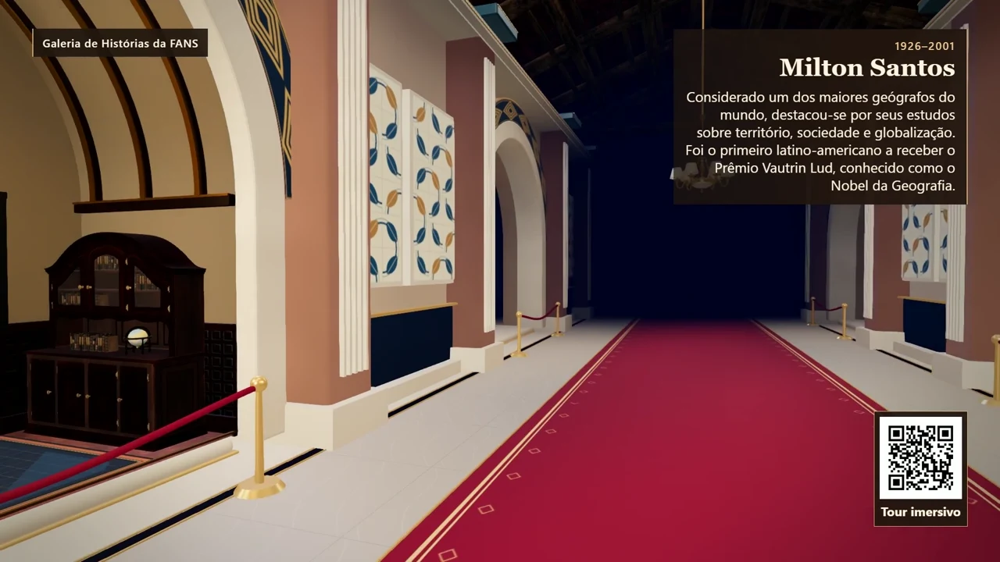
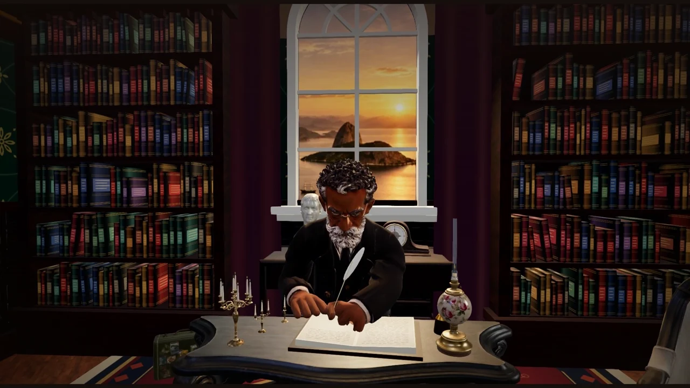

# Galeria de Histórias da FANS

Uma exposição digital sobre dez personalidades negras que marcaram a história do Brasil. Cada sala reúne um retrato e um cenário inspirado na trajetória da pessoa homenageada.

**[Iniciar o tour imersivo](https://galeria-fans-video.pages.dev/)** · **[Assistir ao passeio pelo corredor](https://galeria-fans-video.pages.dev/simplificado)** · [Créditos e licenças](https://galeria-fans-video.pages.dev/creditos)

[](https://galeria-fans-video.pages.dev/simplificado)

## Duas formas de visitar

| Experiência | O que você encontra |
| --- | --- |
| **Passeio pelo corredor** | Vídeo em loop com retratos, biografias breves e um QR code para abrir o tour imersivo. |
| **Tour imersivo** | Visita narrada em tela cheia. A câmera entra nas salas, e os controles permitem pausar ou ir direto ao próximo personagem. |

[](https://galeria-fans-video.pages.dev/)

O percurso passa por **Milton Santos, Luiz Gama, André Rebouças, Aleijadinho, Glória Maria, Machado de Assis, Adhemar da Silva, Nilo Peçanha, Pixinguinha e Pelé**.

## Executar a galeria 3D

```sh
npm ci
npm run dev
```

Abra [a galeria 3D local](http://localhost:5186/). A cena usa Three.js com WebGPU e suporte a WebGL 2. Para gerar o build estático, rode `npm run build`.

- `src/gallery/` contém as salas, a câmera e os controles da galeria.
- `public/` contém os arquivos usados pela cena 3D.
- [editaveis/](editaveis/) contém dez montagens leves em Blender, uma por personagem.
- `site/` contém as páginas e o player das duas experiências em vídeo. As playlists e os segmentos HLS são servidos no Cloudflare Pages. Para publicar uma cópia independente, inclua os diretórios `video-alinhado/` nas rotas correspondentes.

## Downloads da entrega

A [Release da galeria](https://github.com/mateusartur27/galeria-legado/releases/tag/galeria-fans-v1) reúne os dois MP4 finais, as composições HyperFrames com suas mídias e a pasta de publicação do Cloudflare Pages com os streams HLS.

## Realização e créditos

**Turma de Engenharia de Software da Faculdade de Nova Serrana (FANS).**

O código está sob a [licença MIT](LICENSE). Para os modelos, retratos e materiais de terceiros, consulte a [página de créditos e licenças](site/creditos.html) e as [notas de origem dos assets](CREDITS.md).
